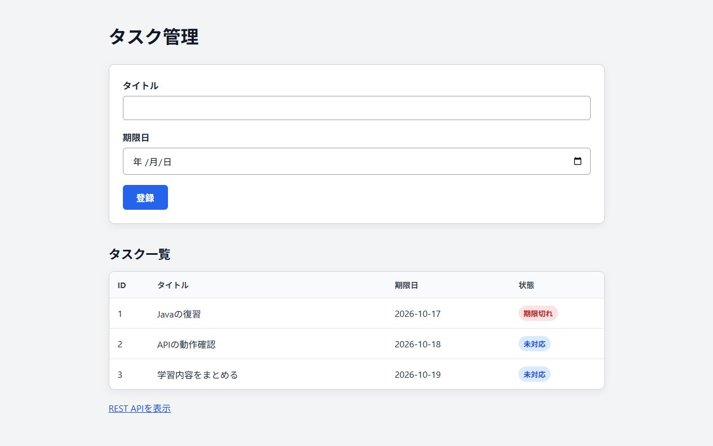

# タスク管理

前の会社での実務や個人での勉強など、いろいろなところで学んだことをもとにしています。
Javaやフレームワーク、アプリの基本をもう一度理解したくて、以前の案件で扱った機能に似たものを作ってみました。
作り方や修正、このREADMEもAIに手伝ってもらっています。

コードと動いた画面を載せています。



## 今できること

タイトルと期限を入れて、登録したものを一覧で見られます。
期限を過ぎたものは、アプリを起動している間に1分くらいで「期限切れ」になります。表示は再読み込みが必要です。

一覧をJSONで見るものもあります。`/api/tasks` です。
完了や編集、削除はまだありません。

## 使ったもの

Java 17、Spring Boot、Thymeleaf、H2など。

## 動かすには

Windowsで確認しています。Java 17を入れて、このREADMEがあるフォルダで実行します。
初回は必要なものがダウンロードされます。

```powershell
.\mvnw.cmd spring-boot:run
```

起動したら <http://127.0.0.1:8080/tasks> を開きます。
終了は `Ctrl+C` です。

登録した内容は `data/` に残ります。ログは `logs/` に出ます。この2つはGitHubには載せていません。
